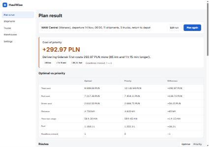
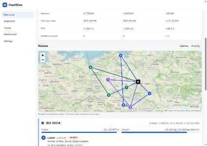

# HaulWise

A dispatcher tool for a fictional Polish logistics company that moves goods between warehouses by truck. For one run from a single depot, HaulWise packs shipments onto trucks, chooses the stop order, and picks the route that is optimal by fuel cost and travel time. The dispatcher can also prioritise deliveries even when that is not the cheapest choice.

**Headline feature: "cost of priority".** The app runs the solver twice — once ignoring priorities (optimal) and once respecting them (priority) — and shows both plans side by side with a plain-language delta, e.g. *"Delivering Gdansk first costs 292.97 PLN more (85 km and 1 h 15 min longer)."*

This is a recruitment-task project: a small, readable, deterministic solver (bin packing + stop ordering + a fuel/cost model) that the author can fully explain, rather than a black-box optimisation library.

## Screenshots



*Plan result — the cost-of-priority banner and the optimal-vs-priority comparison table.*



*Routes — the map and per-truck cards, switchable between the optimal and priority plan.*

Both screenshots were taken from a locally running instance (backend on a spare port, frontend dev server) against the seeded demo data.

## How to run

Prerequisites: **JDK 21**, **Node.js 22.12+** (developed against Node 26), Git. No `.env` file is required — the app runs fully without any API key.

### Backend (PowerShell, terminal 1)

```powershell
cd backend
$env:JAVA_HOME = "C:\Program Files\Java\jdk-21"   # point this shell at JDK 21
.\mvnw.cmd spring-boot:run
```

- API: `http://localhost:8080/api`
- Swagger UI: `http://localhost:8080/swagger-ui.html`
- H2 console: `http://localhost:8080/h2-console` (JDBC URL `jdbc:h2:mem:haulwise`, user `sa`, empty password)
- Demo data (warehouses, trucks, shipments, distance matrix) is **seeded automatically** on every startup into the in-memory database. Set `HAULWISE_SEED_ENABLED=false` to start empty.
- macOS/Linux: `sh mvnw spring-boot:run` instead of `.\mvnw.cmd spring-boot:run`.

### Frontend (PowerShell, terminal 2)

```powershell
cd frontend
npm.cmd install
npm.cmd run dev
```

- UI: `http://localhost:5173`
- The frontend calls the backend **cross-origin** (`5173` → `8080`); CORS is configured and exercised, not bypassed with a dev proxy. Allowed origins come from `HAULWISE_CORS_ALLOWED_ORIGINS` (backend, comma-separated, default `http://localhost:5173,http://127.0.0.1:5173`). The base API URL on the frontend side is `VITE_API_BASE_URL` (default `http://localhost:8080/api`).

`npm.cmd` (rather than the `npm` shim) sidesteps PowerShell's default execution-policy block on `npm.ps1`.

## Architecture

Spring Boot 3.5 + H2 in-memory database on the backend (layered into `controller` / `service` / `repository` / `dto` / a dependency-free `solver` package), React 19 + Vite (plain JavaScript, no TypeScript) with Mantine components on the frontend. The solver is pure Java with no Spring or JPA imports — enforced by an architecture-guard test — so the core algorithm can be read, tested and explained in isolation from the web layer.

Full details — project structure, data model, the complete REST contract, the decision log and the testing strategy — are in [`docs/ARCHITECTURE.md`](docs/ARCHITECTURE.md). Scope, user stories and the task breakdown are in [`docs/PLAN.md`](docs/PLAN.md).

## API

Base path `/api`, JSON only, errors as RFC 9457 `application/problem+json` with a `code` field and a sorted `errors[]` list for validation failures. Full contract, request/response shapes and status codes: `docs/ARCHITECTURE.md` section 5, or the live Swagger UI.

| Method | Path | Purpose |
|---|---|---|
| GET/POST/PUT/DELETE | `/api/warehouses[/{id}]` | CRUD for warehouses |
| GET/POST/PUT/DELETE | `/api/trucks[/{id}]` | CRUD for the truck fleet |
| GET/POST/PUT/DELETE | `/api/shipments[/{id}]` | CRUD for shipments (filterable by `priority`, `originId`) |
| GET | `/api/settings` | Read diesel price, speed fallback, priority weights, compliance limits |
| PUT | `/api/settings` | Replace the settings row |
| GET | `/api/distances` | Full warehouse-to-warehouse distance/time matrix (seeded, with estimated fallbacks) |
| POST | `/api/distances/refresh` | Refresh the matrix from OSRM (optional, not implemented — see Future work) |
| POST | `/api/plans` | Create a plan: pick a depot, shipments and trucks, get back the optimal plan, the priority plan and the cost-of-priority delta |
| GET | `/api/plans/{id}` | Re-fetch a previously created plan by id |

## Algorithm

The solver runs a fixed pipeline per plan request. First, **bin packing** assigns shipments to trucks with first-fit-decreasing (sorted by priority, then size), so results are deterministic and shipments are never split across trucks; anything that doesn't fit is reported as unassigned with a reason. The same assignment is reused for both plan variants, so the two plans differ only in **stop order**, keeping the comparison apples-to-apples. Next, **stop sequencing** finds the cheapest order of stops per truck: brute-force over all permutations for up to 8 stops (the pinned stop, if any, fixed first), falling back to nearest-neighbour construction plus 2-opt improvement above that. Each candidate order is scored by the real fuel/time/cost model, so delivering the heaviest drop first can legitimately win. The solver then runs the whole sequencing step **twice**: once with a pure-cost objective (**optimal**) and once with a **priority objective** that adds a soft, weighted penalty for how late URGENT/HIGH stops are reached plus a hard constraint that a pinned shipment's stop must come first. The two resulting plans are compared, and a **delta** (km, minutes, litres, PLN, and a plain-language sentence) is computed — this is the "cost of priority."

## Fuel and cost model

Fuel consumption is **load-dependent**: for each leg, `litres = distanceKm / 100 × (baseConsumption + extraConsumptionFullLoad × loadFraction)`, where `loadFraction` is the truck's current weight on that leg divided by its payload capacity (so the load — and therefore the fuel burn — drops after each delivery, and stop order genuinely changes the fuel used). Total cost per route is `fuel litres × diesel price (PLN/L) + total hours (driving + service time) × driver cost (PLN/h)`. All parameters (diesel price, per-truck consumption figures, driver cost) are configurable; defaults are typical Polish values (diesel ≈ 6.20 PLN/L, base consumption ≈ 28 L/100 km, +10 L/100 km at full load, driver cost ≈ 45 PLN/h).

## Trade-offs

A production system moving real freight would reach for a dedicated vehicle-routing solver — **OR-Tools** (Google's constraint/routing library) or **Timefold** (formerly OptaPlanner) are the obvious candidates, and both would handle a larger, messier problem (multiple depots, time windows, driver shifts) far better than hand-rolled code. For this task, the scope is deliberately small (one depot per run, atomic shipments, no time windows), and the brief rewards a solution the author can explain end-to-end over one that outsources the hard part to a library. A readable first-fit-decreasing packer plus brute-force/2-opt sequencing, with a transparent cost model, is easy to verify by hand, unit-test with fixed fixtures, and reason about in an interview — at the cost of not scaling to a real multi-depot VRP. That trade-off is intentional and documented in `docs/ARCHITECTURE.md` (decision D-03 and the risk log).

## AI disclosure

This README, the application code, and the accompanying `docs/PLAN.md` / `docs/ARCHITECTURE.md` were produced with AI assistance (Claude Code), with a human reviewing and directing each step. Disclosing this is standard practice for a recruitment task and is noted here plainly: AI was used throughout implementation, not only for this document.

Note: HaulWise's own **optional AI integration** (parsing a plain-language order into a shipment form, or summarising a plan) is part of the original plan but is **not implemented** in this build — the app works fully, and always, without any API key.

## Future work

- **e-TOLL**: Polish road toll calculation (e-TOLL) is out of scope for this task; it would be a natural extension once routes carry real road geometry rather than straight lines between stops.
- EU driving-time compliance warnings (Regulation (EC) 561/2006), load-consolidation suggestions, AI-assisted shipment entry and plan summaries, an OSRM-based live distance refresh, a KPI dashboard, and "urgent re-plan" are all scoped in `docs/PLAN.md` as should-have/extra items beyond the MVP built here.

## Known limitations

- **Seed data and deadlines are relative to the startup day.** Demo shipment deadlines are computed from "tomorrow" at the moment the backend starts; after midnight the still-running demo is effectively planning a day ahead of the seeded deadlines. Restart the backend to get fresh demo deadlines.
- **Daylight-saving transitions are ignored.** Times are plain local `LocalDateTime` values (Europe/Warsaw); a plan whose timeline crosses a DST change will be off by an hour.
- **Nothing is persisted across restarts.** The database is in-memory (H2) and plans live in an in-memory store; both are lost when the backend restarts, and the demo reseeds from scratch.
- **Shipments cannot be split across trucks.** A shipment is atomic — it is assigned whole to one truck, or reported unassigned if it fits none.
- **Settings are not yet editable from the UI.** `GET`/`PUT /api/settings` work via the API/Swagger, but the Settings page in the frontend is currently a placeholder.
- **The map needs internet access** for OpenStreetMap tiles; offline, it degrades to an inline notice while the stop list and timeline (the full text alternative) remain fully usable.
- **Moving a warehouse resets its distance legs to estimates.** Updating a warehouse's coordinates deletes its stored legs (they would be stale); moving it back to the old coordinates does **not** restore the original seeded legs — they stay estimated (haversine × road factor) until the database is reseeded on a restart.
- **A pin can delay a different urgent shipment.** The hard "pin first" rule only guarantees the pinned stop is visited first on its truck; it can push a non-pinned URGENT shipment on the same truck later than it would otherwise go, which QA observed and is intentional (documented) solver behaviour, not a bug.
- **CORS has a default allowed origin** (`http://localhost:5173`/`127.0.0.1:5173`) baked in for local development; change `HAULWISE_CORS_ALLOWED_ORIGINS` for any other setup.
- **No authentication.** This is a single-user demo application; anyone who can reach the API can use it.
- The distance/time matrix is a **seeded approximation** between 9 Polish cities (~70 km/h on motorway/expressway corridors, ~60 km/h otherwise), not real routing data.

## Demo data

Loaded automatically by `SeedDataLoader` on every startup when `HAULWISE_SEED_ENABLED=true` (the default), into an empty database only:

- **9 warehouses**: WAW Central (Warsaw), KRK South (Krakow), GDN Port (Gdansk), POZ West (Poznan), WRO Hub (Wroclaw), LDZ Cross-dock (Lodz), KTW Silesia (Katowice), LUB East (Lublin), SZZ North-West (Szczecin).
- **An approximate distance/time matrix** between all 9 (seeded km/minutes, not real road data — see Known limitations).
- **5 trucks** of varying capacity (10–33 pallets, 6,000–24,000 kg) and consumption profiles.
- **14 shipments**, 11 from WAW Central and 3 from POZ West, covering a mix of priorities and sizes, including: an URGENT shipment to Lublin with a deadline tomorrow 20:00, a HIGH, pinned-first shipment to Gdansk with a deadline tomorrow 12:00 (the shipment the *optimal* plan misses but the *priority* plan meets — the core "cost of priority" story), and one oversized shipment (36 pallets) that exceeds every truck, demonstrating the "unassigned" path.

Running the default WAW Central demo (all 11 WAW shipments, all 5 trucks, return to depot, departure tomorrow 06:00) reproduces the numbers documented in `docs/ARCHITECTURE.md` section 4.1: a delta of roughly +85 km / +75 min / +293 PLN between the optimal and priority plans.

## Environment variables

See `backend/.env.example` and `frontend/.env.example` for the full, commented list. **No API key is required** to run the core application — the optional AI features described in the original plan are not implemented in this build, so no `ANTHROPIC_API_KEY` is needed. The variables that matter for a normal local run are `HAULWISE_CORS_ALLOWED_ORIGINS` (backend) and `VITE_API_BASE_URL` (frontend); both have working defaults for the standard `8080`/`5173` setup.

## Tests

```powershell
# Backend (from backend/, JAVA_HOME pointed at JDK 21)
.\mvnw.cmd test

# Frontend (from frontend/)
npm.cmd test
```

As of this README, the backend suite has **422 tests** (JUnit 5, solver unit tests, an architecture-purity guard, and Spring MockMvc API integration tests, including CORS) all passing, and the frontend suite has **147 tests** across 16 files (Vitest + React Testing Library) all passing. `.\mvnw.cmd -q -B verify` and `npm.cmd test` were both run clean while writing this document.
