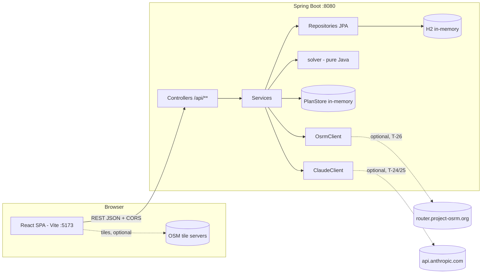
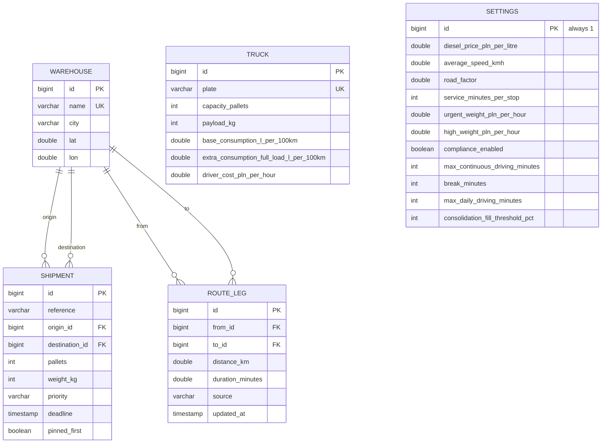

# ARCHITECTURE - HaulWise

Source of truth for the technical design. Read `docs/PLAN.md` for scope. Decisions are referenced as `D-xx`, tasks as `T-xx`.
Versions were checked against Maven Central / npm / start.spring.io on 2026-11-12.

---

## 1. Tech stack

| Area | Choice (version) | Why | Rejected alternative |
|---|---|---|---|
| Language (BE) | Java, `java.version=17` (source/target/release 17), build on **JDK 21** | Plan-fixed level; JDK 21 is LTS and fully supported by Boot 3.5 | Building on JDK 25 (default on PATH): works, but 21 is the safer, documented baseline |
| Framework | **Spring Boot 3.5.16** (last OSS 3.x release, Spring Framework 6.2) | Plan requires 3.x; mature docs and examples | Spring Boot 4.1.2 (current GA) - see D-01 (user approved 3.5.16) |
| Build | Maven + wrapper (`mvnw.cmd`) | Plan-fixed, no Maven install needed | Gradle |
| Persistence | Spring Data JPA + **H2** (version managed by Boot, in-memory `jdbc:h2:mem:haulwise`) | Plan-fixed; zero setup | Postgres (needs Docker) |
| Validation | `spring-boot-starter-validation` (Jakarta Bean Validation) | Declarative, standard 400 handling | Hand-written checks |
| Errors | Spring `ProblemDetail` (RFC 9457) | Built into Spring 6, one standard shape | Custom error envelope |
| API docs | **springdoc-openapi-starter-webmvc-ui 2.8.17** (Swagger UI at `/swagger-ui.html`) | 2.8.x is the line for Boot 3.5 | springdoc 3.x (Boot 4 only) |
| HTTP client (OSRM, Claude) | Spring `RestClient` (JDK HttpClient factory, timeouts) | In the box, synchronous, simple | WebClient (reactive, unnecessary), Anthropic Java SDK (extra dependency; two calls only) |
| Boilerplate | **Java records** for DTOs and solver model; plain classes for JPA entities. **No Lombok** | No annotation-processor/JDK-compat issues; reviewer can read everything | Lombok |
| BE tests | JUnit 5, AssertJ, Spring MockMvc (`spring-boot-starter-test`) | Standard | RestAssured |
| Frontend | **React 19.3** + plain JS, **Vite 8.3** (`@vitejs/plugin-react` 6.x) | Plan-fixed | CRA (dead), Next.js (overkill) |
| UI library | **Mantine 9.8** (`@mantine/core`, `@mantine/hooks`, `@mantine/form`, `@mantine/notifications`) | Polished components, works with plain JS, built-in form validation; requires React ^19.2 | MUI (heavier styling story), hand-rolled CSS |
| Routing | **react-router 7.x** (declarative `<BrowserRouter>` mode) | Ubiquitous docs; v8 (8.5) is recent, v7 API is the well-known one | react-router 8 (fine too, less familiar) |
| Map | **leaflet 1.9.4** + **react-leaflet 5.0.0** (OSM tiles) | Plan assumption; React 19 compatible | Google Maps / MapLibre (key or heavier) |
| FE tests | **Vitest 5.1**, **jsdom 31**, **@testing-library/react 16.3**, `@testing-library/user-event`, `@testing-library/jest-dom` | Native to Vite, Jest-compatible API | Jest (extra Babel config) |
| Lint/format | **oxlint** with the Vite template's `.oxlintrc.json` (create-vite 9 ships oxlint instead of ESLint); Prettier (default config, `npm run format`) | Zero-thought defaults from the template | ESLint flat config (no longer the template default), Checkstyle/Spotless for Java (YAGNI) |

Node v26.13.1 satisfies Vite 8 (`>=22.12`) and Vitest 5 (`>=26`). Scaffold the frontend with `npm.cmd create vite@latest frontend -- --template react` to get matching versions, then add libraries.

---

## 2. System overview



- The SPA calls the backend **cross-origin** (`http://localhost:5173` -> `http://localhost:8080`), so CORS is real and tested (D-07). No Vite proxy.
- Services translate entities into solver inputs (records), call the solver, and map results to DTOs. The solver never sees Spring or JPA.
- Plans are computed on demand and kept in an in-memory `PlanStore` (D-05). They are not JPA entities.
- Everything except map tiles, OSRM refresh and AI works offline.

---

## 3. Project structure

```
HaulWise/
  README.md
  .gitignore                    # target/, node_modules/, dist/, .env, *.iml, .idea/, .vscode/
  docs/  PLAN.md  ARCHITECTURE.md
  backend/
    mvnw  mvnw.cmd  .mvn/wrapper/maven-wrapper.properties
    pom.xml
    .env.example                # ANTHROPIC_API_KEY=, HAULWISE_CORS_ALLOWED_ORIGINS=...
    src/main/java/com/haulwise/
      HaulWiseApplication.java
      config/        CorsConfig, OpenApiConfig, HaulWiseProperties (@ConfigurationProperties record),
                     HttpClientConfig (RestClient beans), ClockConfig (Clock bean, Europe/Warsaw),
                     ValidationConfig, JacksonConfig (strict local date-times)
      controller/    WarehouseController, TruckController, ShipmentController, SettingsController,
                     DistanceController, PlanController, FeatureController, AiController
      service/       WarehouseService, TruckService, ShipmentService, SettingsService,
                     DistanceService, PlanService, PlanStore, AiService
      repository/    WarehouseRepository, TruckRepository, ShipmentRepository,
                     RouteLegRepository, SettingsRepository
      domain/        Warehouse, Truck, Shipment, RouteLeg, Settings (JPA entities), Priority, LegSource (enums)
      dto/           *Request / *Response records + static from(entity) mappers; plan/ sub-package for plan DTOs
      exception/     NotFoundException, ConflictException, UpstreamException, GlobalExceptionHandler
      integration/   OsrmClient, ClaudeClient
      seed/          SeedDataLoader (ApplicationRunner)
      solver/        (pure Java, no Spring/JPA imports - enforced by review and a simple test, see 7)
        model/       SolverInput, ShipmentItem, Priority (solver-side), TruckSpec, CostParameters, PriorityWeights,
                     ComplianceRules, Mode (OPTIMAL|PRIORITY),
                     DistanceProvider, DistanceMatrix, LegDistance, DistanceSource, DirectedPair, GeoPoint (T-05),
                     RouteStop, Leg, Totals, RouteEvaluation (T-06),
                     ShipmentItem, Priority, TruckLoad, PackingResult, Unassigned, UnassignedReason (T-09),
                     Stop, SequencedRoute, SequencingMethod (T-10),
                     PinResolution, Warning, WarningCode (T-11),
                     SolverInput, Mode, SolverResult, PlanVariant, RoutePlan, Delta (T-12; no StopPlan - stops and
                     arrival offsets come from RoutePlan.route(); ComplianceRules added by T-22)
        Planner.java             # T-12 orchestrates the pipeline, runs both modes
        BinPacker.java           # T-09 first-fit-decreasing
        StopGrouper.java         # T-10 shipments -> stops (one per destination), pin winner
        StopSequencer.java       # T-10 brute force / NN + 2-opt
        RouteObjective.java      # T-10 what the sequencer minimises; COST = OPTIMAL mode
        RouteEvaluator.java      # T-06 fuel, time, cost of an ordered route
        PriorityObjective.java   # T-11 penalty term + pin constraint (implements RouteObjective)
        PinConflictResolver.java # T-11 group stops, keep one pin, PIN_CONFLICT warning
        DeltaCalculator.java     # T-12 delta numbers + sentence
        ComplianceChecker.java   # T-22
        ConsolidationAdvisor.java# T-23
        Haversine.java           # great-circle km (used by DistanceService fallback)
    src/main/resources/
      application.yml
      seed/warehouses.csv  seed/matrix.csv  seed/trucks.csv  seed/shipments.csv
    src/test/java/com/haulwise/
      solver/      *Test (pure unit tests, no Spring context), SolverPurityTest (architecture guard)
      controller/  *ApiTest (@SpringBootTest + @AutoConfigureMockMvc)
  frontend/
    package.json  vite.config.js (incl. Vitest config)  .oxlintrc.json  index.html  .env.example
    src/
      main.jsx  App.jsx  theme.js  styles/global.css
      api/         client.js, warehouses.js, trucks.js, shipments.js, settings.js, distances.js,
                   plans.js, features.js, ai.js
      hooks/       useAsync.js, useFeatures.js
      components/
        common/    AppLayout, PageHeader, LoadingState, ErrorState, EmptyState,
                   ConfirmDeleteModal, PriorityBadge
        forms/     WarehouseForm, TruckForm, ShipmentForm, AiOrderInput
        plan/      PlanForm, PlanComparison, DeltaBanner, RouteCard, StopTimeline,
                   UtilisationBar, WarningsList, RouteMap, StopList
      pages/       PlanPage, PlanResultPage, ShipmentsPage, TrucksPage, WarehousesPage,
                   SettingsPage, NotFoundPage
      utils/       format.js (km, PLN, durations via Intl), colors.js (route palette)
      test/        setup.js (jest-dom, matchMedia + ResizeObserver mocks), renderWithProviders.jsx
```

**Naming.** Java: `PascalCase` classes, REST paths plural kebab-case nouns (`/api/route-legs` style if ever needed), JSON fields `camelCase`, enums `UPPER_SNAKE`. Units in field names (`distanceKm`, `durationMinutes`, `weightKg`, `costPln`, `dieselPricePlnPerLitre`). JS: components `PascalCase.jsx`, other modules `camelCase.js`, tests next to the file as `*.test.jsx`.

---

## 4. Data model



| Entity | Fields and constraints |
|---|---|
| **Warehouse** | `id` Long identity; `name` 2..60, unique (case-insensitive check in service); `city` 2..60; `lat` -90..90 (Poland ~49..55 not enforced); `lon` -180..180 |
| **Truck** | `plate` 2..15, unique, uppercase normalised (strip, inner whitespace collapsed to one space, Unicode-aware; spaces are kept, so plates differing only by spaces such as `WX1001A` and `WX 1001A` are different plates - intended); `capacityPallets` 1..40; `payloadKg` 1..40000; `baseConsumptionLPer100Km` (0,100]; `extraConsumptionFullLoadLPer100Km` [0,50]; `driverCostPlnPerHour` [0,1000] |
| **Shipment** | `reference` 1..40 (e.g. "PO-1042"); `origin`, `destination` ManyToOne LAZY, not null, `origin != destination`; `pallets` 1..100; `weightKg` 1..100000 (above-capacity values are allowed so the solver can report them unassigned); `priority` enum `URGENT|HIGH|NORMAL` default NORMAL; `deadline` `LocalDateTime` nullable (Europe/Warsaw implied, D-10); `pinnedFirst` boolean default false. Index on `origin_id`, `priority` |
| **RouteLeg** | Directed pair (both directions stored), unique `(from_id, to_id)`; `distanceKm` > 0; `durationMinutes` > 0; `source` `SEEDED|OSRM`. Estimated (haversine) legs are **never stored** (D-06) |
| **Settings** | Single row, id = 1, created on first access by `SettingsService` (or by the seed) with the section 6.4 defaults. Validated on PUT |

Mapping notes (T-02): entities only carry DB-level constraints (`nullable`, `length`, unique `warehouse.name`, unique `truck.plate`, `route_leg (from_id, to_id)`, check `shipment.origin_id <> destination_id`); range rules live on the request DTOs (section 7). `Truck` normalises its plate (strip, inner whitespace incl. no-break spaces collapsed to one space, upper-case; `Truck.normalisePlate`). `RouteLeg` fields are named `fromWarehouse` / `toWarehouse` (columns `from_id` / `to_id`) because `from`/`to` are JPQL keywords. `Settings.withDefaults()` is the single source of the section 6.4 defaults. Repository queries prepared for T-03/T-05: `WarehouseRepository.existsByNameIgnoreCase[AndIdNot]`, `TruckRepository.existsByPlate[AndIdNot]`, `ShipmentRepository.search(priority?, originId?)` (fetch-joins origin/destination) and `countReferencingWarehouse(id)`, `ShipmentRepository.findWithWarehousesById(id)` (entity graph on origin/destination), `RouteLegRepository.findByFromWarehouseIdAndToWarehouseId` and `deleteByWarehouseId(id)` (flushes first, does not clear the persistence context, so a warehouse edited in the same transaction keeps its changes). With open-in-view off, map `Shipment` to DTOs inside `@Transactional(readOnly = true)` service methods or use `findWithWarehousesById` / `search`.

Deletion rules: deleting a Warehouse referenced by any Shipment -> **409**; otherwise its RouteLegs are deleted first in the same transaction. Updating a Warehouse's lat/lon deletes its stored legs (they would be stale), so it falls back to estimates until an OSRM refresh. Trucks and shipments are freely deletable (plans are snapshots, D-05).

### 4.1 Seed data (T-08)

Loaded by `SeedDataLoader` from CSV resources when `haulwise.seed.enabled=true` (default; `false` in tests). Shipment deadlines are relative to "tomorrow" (from the injected `Clock`) so the demo always shows one missed deadline (re-tuned in T-13: PO-1042, see below).

**Warehouses** (name, city, lat, lon):
WAW Central - Warsaw 52.2297, 21.0122 | KRK South - Krakow 50.0647, 19.9450 | GDN Port - Gdansk 54.3520, 18.6466 | POZ West - Poznan 52.4064, 16.9252 | WRO Hub - Wroclaw 51.1079, 17.0385 | LDZ Cross-dock - Lodz 51.7592, 19.4560 | KTW Silesia - Katowice 50.2649, 19.0238 | LUB East - Lublin 51.2465, 22.5684 | SZZ North-West - Szczecin 53.4285, 14.5528

**Matrix** (`seed/matrix.csv`, one row per unordered pair, loader stores both directions; approximate truck road km / minutes - ~70 km/h on motorway/expressway corridors, ~60 km/h otherwise; documented as approximations in README):

| | KRK | GDN | POZ | WRO | LDZ | KTW | LUB | SZZ |
|---|---|---|---|---|---|---|---|---|
| **WAW** | 295/253 | 340/291 | 310/266 | 345/296 | 135/116 | 290/249 | 170/146 | 565/470 |
| **KRK** | | 590/506 | 455/390 | 270/231 | 275/236 | 80/69 | 270/270 | 640/548 |
| **GDN** | | | 315/270 | 485/416 | 340/291 | 540/463 | 505/435 | 350/350 |
| **POZ** | | | | 180/154 | 215/184 | 375/322 | 475/410 | 240/206 |
| **WRO** | | | | | 220/189 | 200/171 | 440/440 | 370/317 |
| **LDZ** | | | | | | 200/171 | 250/250 | 430/369 |
| **KTW** | | | | | | | 320/320 | 560/480 |
| **LUB** | | | | | | | | 700/600 |

**Trucks**: `WX 1001A` 33 pal / 24000 kg / 28 + 10 L / 45 PLN/h; `WX 2002B` 33 / 24000 / 29 + 10 / 45; `WX 3003C` 18 / 12000 / 22 + 7 / 42; `WX 4004D` 10 / 6000 / 18 + 5 / 40; `PO 5005E` 33 / 24000 / 27 + 10 / 45.

**Shipments** (14): 11 from WAW to a spread of cities (mix of 2-16 pallets, 800-11000 kg), including: PO-1041 URGENT to Lublin (deadline tomorrow 20:00), PO-1042 HIGH pinned to Gdansk with a deadline of **tomorrow 12:00** (the shipment the optimal plan misses), PO-1099 with 36 pallets (exceeds every truck -> unassigned demo). 3 from POZ so the depot selector matters.

**WAW demo** (all 11 WAW shipments, all 5 trucks, default request: return to depot, departure tomorrow 06:00; verified by `PlanSeedDemoApiTest` on the loaded seed and `PlannerSeedTest`): trucks WX 1001A, WX 2002B and PO 5005E are used. WX 1001A: OPTIMAL WAW-Lublin-Krakow-Katowice-Gdansk reaches Gdansk at 23:18 -> PO-1042 `deadlineMissed` + `DEADLINE_MISSED`; PRIORITY WAW-Gdansk-Lublin-Krakow-Katowice reaches Gdansk at 10:51 (met) and Lublin at 18:36 (PO-1041 met; OPTIMAL 08:26). Delta +85 km, +75 min, +292.97 PLN: "Delivering Gdansk first costs 292.97 PLN more (85 km and 1 h 15 min longer)." PO-1099 `EXCEEDS_LARGEST_TRUCK`. No other deadline is missed and there are no plan warnings (all legs seeded).

---

## 5. REST API contract

Base path `/api`. JSON only. Times are ISO-8601 local date-times (`"2026-11-13T06:00:00"`). Request date-times (shipment `deadline`) are local Europe/Warsaw date-times **without offset or zone** (D-10): `2026-11-13T12:00` or `2026-11-13T12:00:00`; a `Z`, `+01:00` or `[Europe/Warsaw]` suffix (or any other format) is rejected with 400 `MALFORMED_REQUEST` "Field 'deadline' must be a local date-time without offset, e.g. 2026-11-13T12:00:00." instead of the offset being silently dropped (`config/JacksonConfig`, strict `LocalDateTime` deserializer); an empty string means no deadline. Numbers in responses: km and litres rounded to 1 decimal, PLN to 2 decimals, minutes integers (rounding only in DTO mapping; solver keeps doubles).

### 5.1 Error format (one shape everywhere)

`Content-Type: application/problem+json` (Spring `ProblemDetail`):

```json
{
  "type": "about:blank",
  "title": "Validation failed",
  "status": 400,
  "detail": "Request has 2 invalid fields.",
  "instance": "/api/shipments",
  "code": "VALIDATION_FAILED",
  "errors": [ { "field": "pallets", "message": "must be greater than or equal to 1" },
              { "field": "destinationId", "message": "must differ from originId" } ]
}
```

`code` values: `VALIDATION_FAILED` (400), `MALFORMED_REQUEST` (400, unreadable JSON / bad enum / type mismatch; `detail` names the field or parameter, and for enums lists the allowed values: "Field 'priority' must be one of URGENT, HIGH, NORMAL." in a body, "Parameter 'priority' must be one of URGENT, HIGH, NORMAL." in a query; enum values are case-sensitive in both, so `urgent` is rejected, and numbers are not accepted as enum indexes (`spring.jackson.deserialization.fail-on-numbers-for-enums: true`), so `"priority": 1` is rejected too), `NOT_FOUND` (404), `CONFLICT` (409), `FEATURE_DISABLED` (503), `UPSTREAM_UNAVAILABLE` (502), `INTERNAL_ERROR` (500, generic message, details only in logs). Other framework statuses use the `HttpStatus` name as `code` (e.g. 405 `METHOD_NOT_ALLOWED`, 415 `UNSUPPORTED_MEDIA_TYPE`). `errors[]` is sorted by field, then message (T-03). `errors` present only for validation. `GlobalExceptionHandler` (`@RestControllerAdvice`) handles `MethodArgumentNotValidException`, `HttpMessageNotReadableException`, `MethodArgumentTypeMismatchException`, `ConstraintViolationException`, own exceptions, and a catch-all. Set `spring.mvc.problemdetails.enabled=true` so framework errors (405, 415, 404 no handler) also use the shape.

### 5.2 Status codes

`GET` 200; `POST` create 201 + `Location` header + body; `PUT` 200 + body; `DELETE` 204; unknown id in path 404; invalid body or invalid referenced id inside a body 400 (field error, e.g. `destinationId: "warehouse 99 does not exist"`); uniqueness / referenced delete 409; AI disabled 503; OSRM/Claude failure 502.

### 5.3 Endpoints

**Warehouses** (T-03, US-1)
| Method | Path | Body | Response |
|---|---|---|---|
| GET | `/api/warehouses` | - | `200 [Warehouse]` sorted by name |
| GET | `/api/warehouses/{id}` | - | `200 Warehouse` / 404 |
| POST | `/api/warehouses` | `WarehouseRequest` | `201 Warehouse` / 400 / 409 (name taken) |
| PUT | `/api/warehouses/{id}` | `WarehouseRequest` | `200 Warehouse` / 400 / 404 / 409 |
| DELETE | `/api/warehouses/{id}` | - | `204` / 404 / 409 ("Warehouse 'GDN Port' is used by 3 shipments.") |

`WarehouseRequest {name, city, lat, lon}`; `Warehouse {id, name, city, lat, lon}`.

**Trucks** (US-2) - same five operations on `/api/trucks`. `TruckRequest {plate, capacityPallets, payloadKg, baseConsumptionLPer100Km, extraConsumptionFullLoadLPer100Km, driverCostPlnPerHour}`; `Truck` = request + `id`. 409 on duplicate plate.

**Shipments** (US-3) - same five operations on `/api/shipments`; `GET /api/shipments?priority=URGENT&originId=1` (both optional filters).
`ShipmentRequest {reference, originId, destinationId, pallets, weightKg, priority, deadline|null, pinnedFirst}`.
`Shipment {id, reference, origin:{id,name,city}, destination:{id,name,city}, pallets, weightKg, priority, deadline, pinnedFirst}` (embedded summaries save the UI a join).

Implementation notes (T-03): DTO records are `WarehouseRequest/Response`, `WarehouseSummary`, `TruckRequest/Response`, `ShipmentRequest/Response` (all numeric request fields are boxed + `@NotNull`, so a missing value is a field error, not 0). `ShipmentRequest.priority` (null -> `NORMAL`) and `pinnedFirst` (null -> false) are optional. Request records clean their text in the compact constructor, so Bean Validation checks the cleaned value: warehouse name/city are stripped with inner whitespace (Unicode-aware, incl. no-break spaces) collapsed to one space (so `"  GDN   Port "` is stored as `GDN Port` and collides with it, 409), shipment reference is stripped, truck plates go through `Truck.normalisePlate` (text fields use `@NotNull` + `@Size`, so blank input yields one size error). Warehouses are listed by name and trucks by plate (both case-insensitive), shipments by id. Service-level field errors are thrown as `RequestValidationException(List<FieldViolation>)`. Shipments are validated in one round by `ShipmentService` (the controller has no `@Valid`): the `ShipmentRequest` Bean Validation rules, warehouse existence and `origin != destination` are collected together, so e.g. out-of-range `pallets` and an unknown `originId` come back in one 400 (sorted by field). All of these 400s are reported before a PUT's unknown-id 404.

**Settings** (T-07)
| GET | `/api/settings` | `200 Settings` |
|---|---|---|
| PUT | `/api/settings` | full `Settings` body -> `200` / 400 |

`Settings {dieselPricePlnPerLitre, averageSpeedKmh, roadFactor, serviceMinutesPerStop, urgentWeightPlnPerHour, highWeightPlnPerHour, complianceEnabled, maxContinuousDrivingMinutes, breakMinutes, maxDailyDrivingMinutes, consolidationFillThresholdPct}`.

Implementation notes (T-07): records `SettingsRequest` / `SettingsResponse` (no `id` in either; all request fields boxed + `@NotNull`, PUT is a full replace). Ranges: `dieselPricePlnPerLitre` (0, 50]; `averageSpeedKmh` [10, 90] (EU truck speed limiter); `roadFactor` [1.0, 3.0] (road km >= great-circle km); `serviceMinutesPerStop` 0..480; `urgentWeightPlnPerHour`, `highWeightPlnPerHour` [0, 10000]; `maxContinuousDrivingMinutes` 30..900; `breakMinutes` 15..180; `maxDailyDrivingMinutes` 60..900; `consolidationFillThresholdPct` 1..100. Cross-field rules in `SettingsService` (field errors via `RequestValidationException`, reported together): `urgentWeightPlnPerHour >= highWeightPlnPerHour` (URGENT never weighs less than HIGH) and `maxContinuousDrivingMinutes <= maxDailyDrivingMinutes`. Both are checked whether or not compliance is enabled. GET creates the row with `Settings.withDefaults()` when it is missing, so it runs in a read-write transaction. A 409 is only possible on a concurrent first access to an empty table (PK race on id 1, caught by the DataIntegrity backstop); it is intentionally not documented in OpenAPI. Fractional values for integer fields are rejected as `MALFORMED_REQUEST` (`spring.jackson.deserialization.accept-float-as-int: false`, applies to all endpoints). No reset endpoint (not in the contract).

**Distances** (T-05, T-26)
| GET | `/api/distances` | `200 {warehouses:[{id,name}], legs:[{fromId,toId,distanceKm,durationMinutes,source:"SEEDED"|"OSRM"|"ESTIMATED"}]}` - complete n x (n-1) matrix, gaps filled with estimates |
|---|---|---|
| POST | `/api/distances/refresh` | `200` same shape after OSRM refresh / 502 if OSRM fails (stored data untouched) |

**Plans** (T-13, US-4..8)
| POST | `/api/plans` | `PlanRequest` -> `201 Plan`, `Location: /api/plans/{id}` / 400 |
|---|---|---|
| GET | `/api/plans/{id}` | `200 Plan` / 404 (also after restart or eviction; any id that is not a stored UUID, incl. a malformed one, is a 404) |

```json
// PlanRequest
{ "depotId": 1, "shipmentIds": [3,4,5], "truckIds": [1,2], "returnToDepot": true,
  "departureTime": "2026-11-13T06:00:00" }   // optional, default: tomorrow 06:00
```
`returnToDepot` is optional, **default `true`** (D-19; PLAN assumption "default on"; the seed demo numbers assume it). `departureTime` is optional, default tomorrow 06:00 from the injected `Clock` (D-10); same strict local date-time format as `deadline` (OpenAPI: `type: string` with a pattern and example, no `format: date-time`, which would imply an offset). A departure in the past is **accepted** on purpose (re-planning or reviewing an earlier day; the dispatcher sees the times in the result). `GET /api/plans/` without an id falls through to Spring's own 404 (same problem shape and `NOT_FOUND` code, framework wording) - accepted. OpenAPI documents only 200/404 for `GET /api/plans/{id}` (a string path parameter cannot be malformed, so `OpenApiConfig` adds no 400 for it).
Validation (T-13, all in `PlanService`, reported together in one 400 like shipments): `depotId` required and must exist ("warehouse 99 does not exist"); `shipmentIds` / `truckIds` required, 1..200 ids ("must not be null", "size must be between 1 and 200"), no null ids ("must not contain null ids"), no duplicates ("must not contain duplicate ids: 3"), all exist ("shipment 99 does not exist" / "trucks 98, 99 do not exist"), every shipment's origin == `depotId` ("PO-2001 (id 12) does not start at depot WAW Central"). Ids are validated before `DistanceService.buildMatrix` is called.

```json
// Plan (response)
{
  "id": "6f1c...uuid", "createdAt": "...", "request": { ...PlanRequest echoed with defaults... },
  "depot": {"id":1,"name":"WAW Central","city":"Warsaw","lat":52.23,"lon":21.01},
  "optimal":  PlanVariant,
  "priority": PlanVariant,
  "delta": { "distanceKm": 38.0, "durationMinutes": 41, "litres": 12.4, "fuelCostPln": 76.85,
             "driverCostPln": 35.50, "costPln": 112.35,
             "noExtraCost": false,
             "sentence": "Delivering Gdansk first costs 112.35 PLN more (38 km and 41 min longer)." },
  "unassigned": [ { "shipmentId": 14, "reference": "PO-1099", "reason": "EXCEEDS_LARGEST_TRUCK",
                    "message": "36 pallets exceed the largest selected truck (33 pallets)." } ],
  "warnings": [ { "code": "PIN_CONFLICT", "severity": "WARNING", "message": "...",
                  "truckId": 1, "shipmentIds": [7, 9] } ]   // shipmentIds: the dropped pins (T-11)
  // "suggestions": [ ] is added by T-23 (consolidation); not part of the T-13 response
}

// PlanVariant
{ "mode": "OPTIMAL",
  "totals": { "distanceKm", "drivingMinutes", "totalMinutes", "litres", "fuelCostPln", "driverCostPln", "costPln" },
  "deadlinesMissed": 1,      // stops reached after their deadline (T-13 addition, for the comparison table)
  "routes": [ {
      "truckId": 1, "plate": "WX 1001A", "colorIndex": 0,
      "utilisation": { "pallets": 28, "capacityPallets": 33, "weightKg": 17400, "payloadKg": 24000,
                       "palletsPct": 84.8, "weightPct": 72.5 },
      "departureTime": "...", "returnTime": "..." ,
      "stops": [ { "sequence": 1, "warehouseId": 3, "name": "GDN Port", "city": "Gdansk", "lat": .., "lon": ..,
                   "shipmentIds": [7], "dropPallets": 10, "dropWeightKg": 6500, "priority": "HIGH", "pinned": true,
                   "legDistanceKm": 340.0, "legDurationMinutes": 291, "legLitres": 118.4, "legCostPln": 776.23, "legSource": "SEEDED",
                   "loadWeightKgOnLeg": 17400, "arrivalTime": "...", "departureTime": "...",
                   "deadline": null, "deadlineMissed": false } ],
      "returnLeg": { "distanceKm", "durationMinutes", "litres", "costPln", "source" } ,   // null if returnToDepot=false
      "totals": { ...same as variant totals... },
      "warnings": [ { "code": "DEADLINE_MISSED", ... }, { "code": "BREAK_REQUIRED", ... } ] } ],
  "warnings": [ ] }
```
Warning codes: `PIN_CONFLICT`, `DEADLINE_MISSED`, `ESTIMATED_DISTANCE` (a leg used haversine), `BREAK_REQUIRED`, `DAILY_DRIVING_EXCEEDED` (T-22). Unassigned reasons: `EXCEEDS_LARGEST_TRUCK` (single shipment bigger than any selected truck in pallets or kg), `NO_CAPACITY_LEFT`.

Plan response rules (T-13):
- **Numbers**: `solver/Rounding.halfUp` via `dto/plan/PlanNumbers` - km, litres and percentages 1 dp, PLN 2 dp, minutes and kg whole numbers (JSON numbers; `BigDecimal` keeps e.g. `340.0`). Totals are rounded from the unrounded sums (a variant total may differ in the last digit from the sum of its rounded routes). The delta object adds `fuelCostPln` and `driverCostPln` to the contract fields; stops add `legCostPln` (leg fuel + driver cost incl. service at that stop), the return leg adds `costPln`.
- **Times**: stop `arrivalTime = departureTime + round(arrivalMinutes)`, stop `departureTime = departureTime + round(arrivalMinutes + serviceMinutes)`, route `returnTime` = arrival back at the depot (null without return). `deadline` = the stop's earliest shipment deadline; `deadlineMissed = arrivalTime > deadline` (compared on the displayed, minute-rounded time).
- **Warnings and severity** (`PlanWarningCode` carries the severity; set in the DTO layer, not the solver): `PIN_CONFLICT` WARNING, plan level, built from the id-only solver warning: "Truck WX 1001A has more than one pinned stop: Gdansk stays first; the pin of PO-1050 was dropped, so it is ordered by priority." (kept city = the pinned stop of the truck's PRIORITY route; references of the dropped pins, plural form for several); `DEADLINE_MISSED` WARNING, in `routes[].warnings` of the variant that misses it, one per late stop, `shipmentIds` = the shipments whose own deadline is missed: "WX 1001A arrives in Gdansk at 2026-11-13 23:18, after the deadline of PO-1042 (2026-11-13 12:00)."; `ESTIMATED_DISTANCE` INFO, plan level, `truckId` null, one warning listing the distinct estimated legs **driven** in either variant (unused estimated matrix legs do not warn), at most 5 named then "and N more". Variant-level `warnings` is reserved and empty in T-13.
- `pinned` (stop) = this stop carries the truck's kept pin-first request (after PIN_CONFLICT resolution); the flag is the same in both variants. Only PRIORITY forces the stop first; OPTIMAL ignores pins, so in OPTIMAL a pinned stop may be at any position (seed demo: Gdansk is stop 4 in OPTIMAL, stop 1 in PRIORITY).
- `colorIndex` = position of the truck in the plan (same in both variants). `unassigned[].reference` comes from the shipment.

**Features and AI** (T-24, T-25 - Should)
| GET | `/api/features` | `200 {"ai": true|false, "osrm": true|false}` |
|---|---|---|
| POST | `/api/ai/parse-shipment` | `{text}` (1..2000 chars) -> `200 ShipmentDraft {reference?, originId?, destinationId?, pallets?, weightKg?, priority?, deadline?, pinnedFirst?, notes}` / 503 / 502 |
| POST | `/api/plans/{id}/summary` | -> `200 {summary}` / 404 / 503 / 502 |

Draft is never saved; the UI pre-fills `ShipmentForm` and the user submits normally. City names in the LLM answer are resolved to warehouse ids **by code** (case/diacritics-insensitive match); unknown -> null.

**Extras**: `POST /api/plans/{id}/replan {shipmentId}` -> `201 Plan` with `changes: [...]` (T-28). KPIs (T-27) are derived on the client from `Plan` - no endpoint.

---

## 6. Solver and cost model (T-06, T-09..T-12, T-22, T-23)

### 6.1 Pipeline

```
SolverInput(depot, shipments, trucks, matrix, costParams, priorityWeights, complianceRules, returnToDepot, departureTime)
  1. BinPacker (once, shared by both modes - D-03)
       sort shipments: priority (URGENT>HIGH>NORMAL), pinned first, pallets desc, weightKg desc, id asc
       sort trucks: capacityPallets desc, payloadKg desc, id asc
       first fit: truck where remaining pallets AND remaining kg suffice
       no fit: EXCEEDS_LARGEST_TRUCK if it fits no empty truck, else NO_CAPACITY_LEFT
  2. StopGrouper: per truck, group shipments by destination -> Stop(dropPallets, dropKg, maxPriority, pinned, earliest deadline)
     Pin conflict (T-11, PinConflictResolver; the Planner uses its stops for both modes): >1 pinned destination on one truck -> keep the destination of the
     first pinned shipment by the sort above (StopGrouper.pinnedWinner), warn PIN_CONFLICT for others
  3. StopSequencer per truck, per mode, minimising objective(order):
       n <= 8 stops (configurable maxBruteForceStops): all permutations (pinned stop fixed at position 1)
       n > 8: nearest neighbour by distance (pinned first) then 2-opt on the objective until no improvement
       tie-break: scores compared at 1e-6 resolution, then lexicographically smaller warehouse-id sequence -> deterministic output
  4. RouteEvaluator scores the chosen order (fuel, time, cost, arrival offsets in minutes after departure);
     PlanResponseMapper (T-13) maps departureTime + minute-rounded arrivalMinutes to arrivalTime and
     deadlineMissed (section 5, "Plan response rules")
  5. ComplianceChecker annotates warnings (T-22)
  6. Optimal-dominance guard: per truck, if the PRIORITY order happens to have lower cost than the OPTIMAL
     order (possible only with the heuristic), use it for OPTIMAL too -> delta is never negative
  7. DeltaCalculator: priority.totals - optimal.totals + sentence
  8. ConsolidationAdvisor (T-23) on the priority variant
```

### 6.2 Cost model (RouteEvaluator, pure)

Per leg i (depot -> stop1 -> ... -> stopN [-> depot]):
- `loadFraction_i = loadKgOnLeg_i / truck.payloadKg` (weight-based, D-04); load decreases after each drop; return leg = 0.
- `litres_i = distanceKm_i / 100 * (base + extraFullLoad * loadFraction_i)`
- `drivingMinutes = sum(legDuration)`; `totalMinutes = driving + serviceMinutesPerStop * N` (+ compliance breaks are reported, not added - D-09).
- `cost = litres * dieselPrice + (totalMinutes / 60) * driverCostPerHour`.
- Arrival at stop k = departure + sum(leg durations up to k) + service * (k-1). RouteEvaluator returns the offset (`Leg.arrivalMinutes`); `PlanResponseMapper` (T-13) adds `departureTime` to the minute-rounded offset and sets `deadlineMissed = arrival > deadline` (section 5, "Plan response rules").

Worked check for tests: 100 km, base 28, extra 10, load 12000/24000 -> 100/100 * (28 + 5) = 33.0 L.

### 6.3 Objective and priority (PriorityObjective)

- `OPTIMAL`: `objective = cost` (priorities and pins ignored).
- `PRIORITY`: `objective = cost + sum over stops (weight(maxPriority) * arrivalHoursSinceDeparture)`, with `URGENT = urgentWeightPlnPerHour (150)`, `HIGH = highWeightPlnPerHour (50)`, `NORMAL = 0`; plus hard constraint: pinned stop at position 1.
- One penalty per stop, by its most important shipment; URGENT and HIGH at the same stop are not added.
- The penalty is used only for choosing the order; reported costs are always pure `cost`. Weights in PLN/hour make the trade-off explainable: "an urgent delivery is worth 150 PLN per hour earlier".

### 6.4 Configurable parameters and defaults

| Parameter | Default | Where |
|---|---|---|
| dieselPricePlnPerLitre | 6.20 | Settings (UI) |
| averageSpeedKmh (estimate fallback) | 70 | Settings |
| roadFactor (haversine -> road km) | 1.3 | Settings |
| serviceMinutesPerStop | 30 | Settings |
| urgentWeightPlnPerHour / highWeightPlnPerHour | 150 / 50 | Settings |
| complianceEnabled | true | Settings |
| maxContinuousDrivingMinutes | 270 (4.5 h) | Settings |
| breakMinutes | 45 | Settings |
| maxDailyDrivingMinutes | 540 (9 h) | Settings |
| consolidationFillThresholdPct | 60 | Settings |
| maxBruteForceStops | 8 (allowed 0..9) | `application.yml` (`haulwise.solver.max-brute-force-stops`) |
| per-truck consumption, payload, driver cost | per truck | Truck entity |

EU Regulation (EC) 561/2006 values used (implementer re-verifies in T-22 and cites Art. 6 and 7 in README): after **4.5 h** of driving a break of at least **45 min** (may be split 15 + 30 min); daily driving max **9 h**, extendable to **10 h at most twice a week**; daily rest 11 h (out of scope); weekly 56 h / fortnightly 90 h (out of scope - single run). The 10 h extension is mentioned in the README only, not modelled.

ComplianceChecker: walk legs accumulating driving minutes (service time counts as non-driving, but per 561/2006 only a real break resets the 4.5 h counter - so service does **not** reset it); when a leg pushes continuous driving past the limit, emit `BREAK_REQUIRED` with the leg ("WAW Central -> GDN Port") and suggestion "Take a 45 min break before ~10:30". Total driving > max daily -> `DAILY_DRIVING_EXCEEDED`.

### 6.5 Delta sentence (DeltaCalculator)

- No truck loaded (every selected shipment unassigned, both variants without routes): zeros, `noExtraCost = true` and the sentence "No shipments could be loaded onto the selected trucks, so there is nothing to compare." (T-13 QA; "costs nothing extra" would be misleading there).
- `noExtraCost = |delta.costPln| < 0.50 && |delta.distanceKm| < 0.5` -> sentence "Respecting priorities costs nothing extra."
- Otherwise: subject = cities of pinned / URGENT / HIGH stops that the PRIORITY variant visits **earlier** on their truck than the OPTIMAL variant (T-12: stops merely pushed later by another stop's pin are not named - on the seed demo the pin moves the URGENT Lublin from 1st to 2nd, and "Prioritising Gdansk, Lublin and Krakow" would be misleading; a pinned stop already first in OPTIMAL is not named either), ordered pinned first, then URGENT, HIGH, then truck and position; each city once; max 3, then "and N more"; when all such stops are pinned and name a single city (also the same city on several trucks) -> "Delivering Gdansk first", else "Prioritising A, B and C"; fallback subject "Respecting priorities".
- Template: cost is the main clause, distance and time follow in words so negatives read naturally: `"{subject} costs 292.97 PLN more (85 km and 1 h 15 min longer)."`; mixed signs `"Prioritising Lublin costs 30.00 PLN more (12 km shorter, 40 min longer)."`; a component that rounds to 0 is omitted (`"(40 min longer)"`); if both round to 0 the parentheses are dropped (`"... costs 0.60 PLN more."`). A negative cost (impossible from the Planner, D-14) reads "less". Numbers: PLN with 2 decimals, whole km, whole minutes as `41 min` (under an hour), `1 h 15 min`, `2 h` (minutes 0). All rounding goes through `solver/Rounding.halfUp(value, scale)` (half-up away from zero on the exact decimal form).
- Formatting helpers are pure and unit-tested; the frontend displays the sentence and also renders the numbers itself in the comparison table.

### 6.6 Distances (DistanceService, T-05, T-26)

`DistanceService.buildMatrix(warehouseIds)` returns a solver `DistanceMatrix` (immutable, indexed by warehouse id):
1. Stored `RouteLeg` (SEEDED or OSRM) if present.
2. Else estimate: `Haversine.km(a, b) * roadFactor`, minutes = `km / averageSpeedKmh * 60`, source `ESTIMATED` (plan gets an `ESTIMATED_DISTANCE` warning).

OSRM (optional, T-26): `POST /api/distances/refresh` calls `GET {osrmBaseUrl}/table/v1/driving/{lon,lat;...}?annotations=distance,duration` once for all warehouses (connect 3 s / read 10 s timeout), upserts legs with source `OSRM`. OSRM car durations are multiplied by `haulwise.osrm.truck-duration-factor` (1.2). Failure -> 502, existing data untouched. Never called at startup or during planning, so the app is fully offline-safe. "Cache" = the persisted legs themselves (D-06).

---

## 7. Cross-cutting concerns

- **Validation**: Bean Validation on request records (`@NotBlank`, `@Size`, `@DecimalMin/Max`, `@Positive`, `@NotNull`, `@NotEmpty`); cross-field and existence checks in services, thrown as a `RequestValidationException(field, message)` mapped to the same 400 shape. Where both apply (shipments), the service runs the injected `Validator` itself and reports Bean Validation and service errors in one response. Client-side validation mirrors the main rules via `@mantine/form`; server errors are mapped onto form fields with `form.setErrors(fieldErrors)`. Validation messages are **always English** (API and seed), regardless of the JVM locale or `Accept-Language`: `config/ValidationConfig` replaces Boot's `defaultValidator` with a `LocalValidatorFactoryBean` whose interpolator always uses `Locale.ENGLISH` (D-18).
- **CORS** (T-04): `CorsConfig implements WebMvcConfigurer`, mapping `/api/**`, origins from `haulwise.cors.allowed-origins` (env `HAULWISE_CORS_ALLOWED_ORIGINS`, comma-separated, default `http://localhost:5173,http://127.0.0.1:5173`), methods `GET,POST,PUT,DELETE,OPTIONS`, headers `Content-Type,Accept`, exposed header `Location`, `allowCredentials=false`, `maxAge=3600`. No wildcard.
- **Configuration**: `application.yml` with `${ENV:default}` placeholders, bound to a `HaulWiseProperties` record. Local secrets via `backend/.env` imported with `spring.config.import: optional:file:.env[.properties]` (git-ignored; `.env.example` committed). Keys: `ANTHROPIC_API_KEY`, `HAULWISE_AI_MODEL` (developer sets a current Claude model id from Anthropic docs at implementation time), `HAULWISE_CORS_ALLOWED_ORIGINS`, `HAULWISE_OSRM_BASE_URL` (default `https://router.project-osrm.org`), `HAULWISE_SEED_ENABLED`, `HAULWISE_H2_CONSOLE_ENABLED` (default `true`). Frontend: `frontend/.env` -> `VITE_API_BASE_URL` (default `http://localhost:8080/api`).
- **Persistence settings**: `spring.jpa.hibernate.ddl-auto=create-drop`, `spring.jpa.open-in-view=false`, H2 console at `/h2-console`: enabled by default (`HAULWISE_H2_CONSOLE_ENABLED`), localhost-only (`web-allow-others` never set), disabled in tests. Tests use the shared `@HaulWiseApiTest` meta-annotation (seed off, console off, empty AI key, own `jdbc:h2:mem:test-<uuid>` DB per context) so a local `.env` cannot leak in. Transactions at service level (`@Transactional(readOnly = true)` on reads).
- **Time**: injected `Clock` (Europe/Warsaw) - only services read the clock; the solver gets `departureTime` as input. The strict `LocalDateTime` deserializer (`config/JacksonConfig`, rejects offsets) applies to every Boot-mapped `ObjectMapper`; external clients that may receive offset date-times (Claude T-24/T-25, OSRM T-26) use their own mapper or `OffsetDateTime`.
- **Logging**: default Logback. INFO: startup seed summary, plan solved (`planId, shipments, trucks, ms`). WARN: OSRM/Claude failure, estimated legs used. Never log the API key or full LLM prompts.
- **Security basics**: no auth (Won't); input size limits (`text` 2000 chars, list sizes <= 200); generic 500 message; API key only server-side and never returned; `/api/features` exposes only booleans; LLM output is parsed into a typed draft and validated - never trusted as numbers for the plan.
- **AI**: `ClaudeClient` with `RestClient` -> `POST https://api.anthropic.com/v1/messages` (headers `x-api-key`, `anthropic-version: 2023-06-01`), timeout 20 s. Parse: system prompt asks for JSON only with the `ShipmentDraft` fields + list of known city names; response JSON parsed with Jackson, invalid -> 502. Summary: prompt receives only the computed `Plan` numbers; instructs "do not invent numbers". `ai` feature = key present.

---

## 8. Frontend design (T-14..T-17, T-19, T-20)

- **Layout**: Mantine `AppShell` with navbar: *Plan a run* (`/`), *Shipments*, *Trucks*, *Warehouses*, *Settings*; result at `/plans/:id`. Responsive: navbar collapses to burger below `sm`; plan comparison becomes stacked tabs on mobile.
- **API client** (`api/client.js`): `request(method, path, body)` on `fetch`, base URL from `import.meta.env.VITE_API_BASE_URL`; on non-2xx parses problem+json into `ApiError {status, code, title, detail, fieldErrors: {field: message}}`; network failure -> `ApiError {code: 'NETWORK'}` with message "Cannot reach the HaulWise server. Is the backend running on :8080?". Resource modules export plain functions (`listShipments(filters)`, `createPlan(req)`, ...).
- **State**: no global store. Page-level state + a small `useAsync(fn)` hook (`{data, error, loading, reload}`; `fn` is wrapped in `useCallback` by the caller with the values it reads, e.g. filters, as dependencies - T-14 changed this from `useAsync(fn, deps)` so oxlint's `exhaustive-deps` checks the dependencies). Features fetched once in `useFeatures` (context). Plan result is re-fetchable by URL via `GET /api/plans/{id}`; if 404 (restart), show "This plan expired - plan again" with a link.
- **CRUD pages**: Mantine `Table` + `Modal` forms (create/edit share one form component), `ConfirmDeleteModal`, notifications on success, 409 shown as a notification with the server `detail`. Shipments: `SegmentedControl`/chips filter by priority, `PriorityBadge` colours (URGENT red, HIGH orange, NORMAL gray). Deadline input: `TextInput type="datetime-local"` (avoids `@mantine/dates` + dayjs, D-11).
- **Plan page**: depot `Select` -> shipments list filtered to that origin (checkboxes, all preselected), trucks (checkboxes), return-to-depot `Switch`, departure time; submit -> navigate to `/plans/:id`.
- **Result page**: `DeltaBanner` (headline sentence, green "no extra cost" variant) -> `PlanComparison` (two columns: totals table optimal vs priority with delta column) -> `RouteMap` -> per-truck `RouteCard` (colour chip, `UtilisationBar` pallets + kg, `StopTimeline` with Mantine `Timeline`, arrival times, deadline/priority badges) -> `WarningsList` + unassigned list. Toggle which variant the map/cards display.
- **Map** (`RouteMap`): `MapContainer` fitted to bounds; numbered markers via `L.divIcon` (avoids the known Leaflet default-icon bundling issue); straight `Polyline` per truck in its colour (no road geometry - D-08). Offline: listen to `tileerror`; after the first error show an inline `Alert` "Map tiles unavailable (offline). Stops and timeline below are complete." Markers and lines still render on a blank background. Import `leaflet/dist/leaflet.css` once.
- **States**: every data view uses `LoadingState` (skeleton), `ErrorState` (message + Retry), `EmptyState` (call to action, e.g. "No trucks yet - add your first truck").
- **Styling**: Mantine theme in `theme.js` (primary colour, radius, font) = design tokens; `global.css` minimal. Formatting via `Intl.NumberFormat('en-GB', {style:'currency', currency:'PLN'})`.

### 8.1 Visual design - approved by the user 2026-11-13

Mockups: https://claude.ai/artifact/RvufXouJutNaGMx36TmZH6 (the tokens below are the binding spec). Implemented in `theme.js` (Mantine palettes, `theme.other.tokens`, `theme.other.priorityTags`, `--hw-*` CSS variables via `cssVariablesResolver`, which also maps Mantine's text / dimmed / default-border colours) and `utils/colors.js`; components use these, never literal colours.

| Token | Value |
|---|---|
| Primary ("brand", custom 10-shade palette, shade 6 = base) | `#1D5FD1`; hover / dark (shade 7) `#163F8C`; light (shade 0) `#EAF1FD` |
| Accent ("priority" palette, shade 6) | `#B54708` |
| Page background / surface / borders | `#F5F6F8` / `#FFFFFF` / `#E3E6EA` |
| Text / muted (>= 4.5:1 on white) | `#15181C` / `#5B6470` |
| Success / danger | `#067647` / `#B42318` |
| Font | Inter (Google Fonts link in `index.html`, `system-ui` fallback when offline), headings 700 |
| Radius / buttons | md 8 px, cards and papers 10 px; default-size buttons 40 px tall |
| Priority tags (pill) | URGENT bg `#FEE4E2` text `#B42318`; HIGH bg `#FEF0C7` text `#93370D`; NORMAL bg `#F2F4F7` text `#475467`. Pinned: outline pill "Pinned first" |
| Route colours by `colorIndex` (`routeColor`, cycles) | 0 `#1D5FD1`, 1 `#7A5AF8`, 2 `#0E9384`, 3 `#C11574`, 4 `#CA8504`, 5 `#475467` |

Shell: white header bar 60 px with a bottom border; brand = 28 px blue rounded square with a white "H" + "HaulWise"; nav items, active = `#EAF1FD` background, `#163F8C` text, weight 600; page content on the grey page background.

Screens (T-15..T-17):
- **Shipments** (T-15): `PageHeader` with an "Add shipment" button; filters = origin `Select` + priority `SegmentedControl` (All / Urgent / High / Normal); table columns: reference, route ("WAW Central → Lublin"), pallets, weight, priority tag + "Pinned first" tag, deadline ("13 Nov, 20:00", "-" when none), Edit / Delete buttons (delete confirmed in `ConfirmDeleteModal`). Add/edit in a `Modal` (one form for both): server field errors under the matching fields, other errors (e.g. 409) in a form-level `Alert` above the buttons. Trucks and Warehouses follow the same table + modal pattern.
- **Plan result** (T-16/T-17), top to bottom: run summary bar (depot, departure, shipment and truck counts; "Edit run" and "Plan again" buttons); cost-of-priority banner (big "+292.97 PLN", the delta sentence, chips for km / time / litres, "Deadlines missed: 1 → 0"; green "no extra cost" variant); comparison table with columns Optimal / Priority / Difference (difference = `delta` as delivered); **Routes** section with an Optimal / Priority `SegmentedControl` that drives both the map and the truck cards; truck cards (route colour chip, plate, utilisation bars for pallets and kg, numbered stop list with arrival time, deadline status "on time" / "11 h 18 min late", priority tag, pinned tag - "Pinned first - ignored by optimal" in the OPTIMAL view); trucks whose route is identical in both plans are collapsed as "Same in both plans"; a "Not used: WX 3003C, WX 4004D" line for selected trucks without shipments; bottom panels "Not loaded" (unassigned with reasons) and "Warnings".

---

## 9. Testing strategy

| Layer | Tool | What |
|---|---|---|
| Solver unit (T-06, T-09..12, T-22, T-23) | JUnit 5 + AssertJ, no Spring | Cost model hand-computed fixtures (33.0 L example); heavy-drop-first < reverse litres (US-5); brute force equals exhaustive optimum on fixtures; NN+2-opt never worse than NN; FFD: atomicity, kg and pallet limits, both unassigned reasons, priority-first packing; pin is position 1; pin conflict warning; URGENT moved earlier in PRIORITY mode; delta values + "no extra cost" + sentence text; determinism (same input twice = equal output); compliance break detection with 4.5 h / 9 h boundaries |
| Architecture guard | plain JUnit | Scan `solver` source files: no import (plain or `import static`) whose name starts with `org.springframework.`, `jakarta.persistence.`, `org.hibernate.` or `com.haulwise.domain.` (cheap, makes the "pure solver" claim verifiable; the solver has its own model, incl. `Priority`). Implemented in T-02 as `SolverPurityTest` |
| API integration (T-18) | `@SpringBootTest` + `@AutoConfigureMockMvc`, H2, seed disabled (`@TestPropertySource(properties="haulwise.seed.enabled=false")`), fixtures created per test via repositories, `@Transactional` rollback or `deleteAll` in `@BeforeEach` | CRUD happy paths with 201 + Location / 204; 400 with `errors[]` shape; 404; 409 referenced warehouse delete and duplicate plate; 400 malformed JSON and bad enum; CORS: preflight `OPTIONS` with `Origin: http://localhost:5173` -> 200 + `Access-Control-Allow-Origin`, disallowed origin -> 403; `POST /api/plans` returns both variants + delta and `GET` by id; plan validation (shipment from another depot -> 400); `/api/features` with no key -> `ai:false`; AI endpoints -> 503 without key. Use `@MockitoBean` (not deprecated `@MockBean`) to stub `ClaudeClient`/`OsrmClient` |
| Frontend (T-19) | Vitest + jsdom + RTL + user-event | `ShipmentForm` client validation and server field-error mapping; `DeltaBanner` text + "no extra cost" variant; `WarningsList` renders codes; `api/client` maps problem+json to `ApiError` (mock `fetch`). `RouteMap` is mocked in page tests (Leaflet does not render in jsdom). Setup file mocks `window.matchMedia` and `ResizeObserver` (required by Mantine) |
| Manual / QA (T-29) | - | Clean clone, no `.env`, network off: CRUD, plan, map degradation |

No e2e framework (time). Coverage tooling optional.

---

## 10. Dev experience (Windows PowerShell)

Prerequisites: JDK 21, Node 22.12+ (26 present), Git. Ports: backend 8080, frontend 5173.

```powershell
# Backend (terminal 1) - point this session at JDK 21 (JDK 25 also works, 21 is the documented baseline)
$env:JAVA_HOME = "C:\Program Files\Java\jdk-21"
cd backend
.\mvnw.cmd spring-boot:run          # API http://localhost:8080/api, Swagger http://localhost:8080/swagger-ui.html
.\mvnw.cmd test                     # backend tests
# macOS/Linux: sh mvnw spring-boot:run   (mvnw is committed without the executable bit on purpose - user decision)

# Frontend (terminal 2)
cd frontend
npm.cmd install
npm.cmd run dev                     # http://localhost:5173
npm.cmd test                        # vitest run
npm.cmd run lint
```

- `npm.cmd` sidesteps the PowerShell execution-policy block on `npm.ps1`; alternative: `Set-ExecutionPolicy -Scope CurrentUser RemoteSigned`.
- To set JAVA_HOME permanently: `[Environment]::SetEnvironmentVariable("JAVA_HOME","C:\Program Files\Java\jdk-21","User")` then reopen the terminal.
- `package.json` scripts: `dev`, `build`, `preview`, `test` (`vitest run`), `test:watch` (`vitest`), `lint`, `format` (`prettier --write src`).
- Seed data loads on every start (in-memory DB). H2 console: `http://localhost:8080/h2-console`, JDBC URL `jdbc:h2:mem:haulwise`, user `sa`, empty password.
- **T-01 scaffold note**: start.spring.io no longer offers Boot 3.x. Generate a Maven/Java 17 project there (any offered Boot version) to obtain `mvnw`, `mvnw.cmd`, `.mvn/`, then replace `pom.xml` with parent `spring-boot-starter-parent:3.5.16` and starters `web`, `data-jpa`, `validation`, `test`, plus `com.h2database:h2` (runtime) and `springdoc-openapi-starter-webmvc-ui:2.8.17`. Verify `.\mvnw.cmd -v` and `.\mvnw.cmd test` before committing.

---

## 11. Decision log

| ID | Decision | Reason | Consequences |
|---|---|---|---|
| D-01 | Spring Boot **3.5.16**, Java 17 level, build on JDK 21 - **approved by the user** (Boot 4.1.2 rejected) | PLAN fixes Boot 3.x; 3.5.16 is the last OSS 3.x patch (OSS support ended 2026-06-30) | No further free patches; Initializr cannot generate it (manual pom, wrapper files taken from an Initializr project: Maven Wrapper 3.3.4, Maven 3.10.0). Boot 4.x would have meant Jackson 3, modular starters, springdoc 3.x |
| D-02 | Records for DTOs/solver model, no Lombok | Avoid annotation-processor/JDK 25 issues; explicit code | Entities have hand-written getters/setters (5 small classes) |
| D-03 | Bin packing runs **once** (priority-then-size order) and both variants share the assignment; only stop order differs | Makes "cost of priority" an apples-to-apples comparison of the same trucks and shipments; matches PLAN's sort order | Delta does not capture assignment effects; documented. FFD ignores geography (README trade-off, OR-Tools/Timefold as production answer) |
| D-04 | Load fraction for fuel is by **weight** (kg / payload) | Fuel depends on mass, not pallet count | Pallets only constrain capacity |
| D-05 | Plans are not JPA entities; kept in in-memory `PlanStore` (UUID, LRU cap 50 - access-ordered `LinkedHashMap`, a GET counts as use, synchronized); `POST /api/plans` returns 201 + Location | REST-friendly result URL, enables AI summary and re-plan by id, no complex schema | Plans vanish on restart -> UI handles 404 |
| D-06 | Matrix: stored directed `RouteLeg`s (SEEDED/OSRM); haversine x roadFactor estimates computed on the fly, never stored; OSRM only on explicit refresh | Offline-first, deterministic, simple "cache" | New warehouses are estimated until refresh |
| D-07 | Frontend calls backend cross-origin; no Vite proxy | CORS is an evaluation criterion and must be exercised | Base URL via `VITE_API_BASE_URL` |
| D-08 | Map draws straight lines between stops | No routing geometry needed offline | README notes it is schematic |
| D-09 | EU compliance is a **check with warnings** (break suggestion), not added to the schedule | Keeps the timeline simple, matches US-9 AC | Arrival times exclude mandatory breaks; warning tells the dispatcher |
| D-10 | Times are `LocalDateTime` in Europe/Warsaw; injected `Clock`; default departure tomorrow 06:00 | Single-country tool; testable | No zone handling |
| D-11 | Native `datetime-local` input instead of `@mantine/dates` | Fewer dependencies | Slightly plainer picker |
| D-12 | Errors use Spring `ProblemDetail` + `code` + `errors[]` | Standard (RFC 9457), built-in | Frontend parses one shape |
| D-13 | Priority penalty = weight (PLN/h) x arrival hours; affects ordering only, never reported cost | Explainable, tunable in Settings | Weights must exceed driver cost/h to change orders (defaults 150/50 vs 45) |
| D-14 | Optimal-dominance guard (step 6.1.6) | Heuristic could otherwise show a negative "cost of priority" | Cost delta always >= 0; km and time deltas may be negative (see 6.5) |
| D-15 | Shipment validation allows pallets up to 100 / kg up to 100000 | Lets the solver demonstrate `EXCEEDS_LARGEST_TRUCK` instead of the form blocking it | Form shows a hint when above the largest truck |
| D-16 | react-router 7 (not 8), Mantine 9, Vitest 5 | Familiar, documented APIs; all React 19 compatible | Upgrade path to v8 trivial later |
| D-17 | Claude via `RestClient`, not SDK; model id from env | Two calls only; no extra dependency; model ids change | Developer confirms current model id + API version from Anthropic docs in T-24 |
| D-19 | Plan defaults: `returnToDepot = true`, departure tomorrow 06:00 (T-13) | PLAN assumption "return to depot (default on)"; D-10 | The seed demo story (PO-1042 missed by OPTIMAL at 23:18, met by PRIORITY at 10:51) is tuned for these defaults |
| D-18 | API and seed validation messages are always English (`ValidationConfig`, fixed-locale interpolator) | The UI and README are English; on a pl-PL machine Hibernate Validator otherwise answered in Polish, and error text should not depend on the server's locale | No localisation of error messages (not needed; single-language UI) |

---

## 12. Task mapping (annotations to PLAN)

Order unchanged except: **T-07 (Settings) before T-06 wiring** is fine since T-06 is pure and takes `CostParameters`; **T-08 seed** depends on T-02 and T-05 (matrix CSV). Suggested Day-1 order: T-01, T-02, T-03, T-04, T-06, T-05, T-07, T-08.

| Task | Technical notes |
|---|---|
| T-01 | See section 10 scaffold note; root `.gitignore`; `backend/.env.example`, `frontend/.env.example` |
| T-02 | Entities in `domain/`; `Settings` single row; indexes per section 4; `RouteLeg` unique constraint |
| T-03 | Records + `from()` mappers; `GlobalExceptionHandler`; 201 + Location via `ServletUriComponentsBuilder`; 409 rules section 4. `GlobalExceptionHandler` also maps `DataIntegrityViolationException` to 409 `CONFLICT` as a backstop (the DB unique on `warehouse.name` is case-sensitive while the service check is case-insensitive; races). Add an API test "update warehouse coordinates -> GET returns the new values and no legs remain" |
| T-04 | `CorsConfig` + `OpenApiConfig` (title, version); springdoc 2.8.17. Done: `HaulWiseProperties` (only the `cors` group so far; later tasks add theirs; wildcard/empty origins fail startup); controllers carry `@Tag`/`@Operation` summaries, `@ResponseStatus` (201/204, docs only - runtime status still comes from `ResponseEntity`) and `@ConflictResponse` (`controller` package; adds a documented 409); an `OpenApiCustomizer` adds a `Problem` schema and attaches it as `application/problem+json` to 400 (body or parameters), 404 (operations with a path parameter) and every other 4xx; `springdoc.default-produces/consumes-media-type: application/json`; API version `0.1.0` (matches the pom); origins `*` and `null` fail startup. Swagger order: the API description names all resources; a second `OpenApiCustomizer` sorts the tags as Warehouses, Trucks, Shipments, Settings, Distances (`OpenApiConfig.TAG_ORDER`, unknown tags after) and the paths by key; no `springdoc.swagger-ui.*-sorter` is set, so Swagger UI keeps the spec order and each resource reads list, create, get, update, delete |
| T-05 | `DistanceService`, `Haversine`, `GET /api/distances`; matrix CSV from section 4.1. Read `RouteLeg` from/to ids via a query projection or fetch join, not via lazy proxy id access. Done: solver side (pure) `solver/Haversine`, `solver/DistanceMatrixBuilder` (stored leg wins, else haversine x roadFactor at averageSpeedKmh), `solver/model/{DistanceProvider, DistanceMatrix, LegDistance, DistanceSource (SEEDED/OSRM/ESTIMATED), DirectedPair, GeoPoint}`; same warehouse = `LegDistance.ZERO` (not an estimate). Road factor and average speed come from the Settings row via `SettingsService.estimateParameters()` (internal record `EstimateParameters`; `SettingsResponse` is API-only; no `haulwise.solver.*` keys for them). `RouteLegRepository.findLegsBetween(ids)` returns `StoredLeg` id projections (JPQL constructor expression). `DistanceService.buildMatrix(ids)` (id order, unknown id -> `IllegalArgumentException`, callers validate first) and `getMatrix()` (all warehouses by name, legs row by row). DTO `DistanceMatrixResponse {warehouses:[{id,name}], legs:[{fromId,toId,distanceKm (1 dp),durationMinutes (int),source}]}`. `seed/matrix.csv` header `from,to,distance_km,duration_minutes`, warehouses by **name**, one row per unordered pair (36); `seed/MatrixCsvParser` validates it (`SeedDataException` with line number; strips a UTF-8 BOM; does not close the caller's `Reader`) and `MatrixCsvRow.reversed()` gives the other direction - persisting legs at startup is T-08 |
| T-06 | `RouteEvaluator` + `CostParameters`; tests incl. 33.0 L example and heavy-first. Done: `solver/model/{CostParameters(dieselPricePlnPerLitre, serviceMinutesPerStop), TruckSpec(id, capacityPallets, payloadKg, baseConsumptionLPer100Km, extraConsumptionFullLoadLPer100Km, driverCostPlnPerHour), RouteStop(warehouseId, dropWeightKg), Leg, Totals, RouteEvaluation(stopLegs, Optional returnLeg, totals)}`; records validate nonsensical values (`IllegalArgumentException`). `new RouteEvaluator(DistanceProvider, CostParameters).evaluate(depotId, stops, truck, returnToDepot)`: rejects a stop at the depot, a warehouse twice and total drops above payload; empty route = no legs and `Totals.ZERO` (no depot->depot leg). Service time is charged at the leg's destination stop (never at the depot), so per-leg `driverCostPln = (driving + service) / 60 x rate` and leg values sum to the totals. `Leg.arrivalMinutes` is the offset from departure; RouteEvaluator does not check deadlines - **T-13 Planner maps departureTime + arrivalMinutes to arrivalTime and deadlineMissed**; minutes are `double` throughout the solver; model records share `Checks.requireNonNegative` (package-private); `Totals` adds `serviceMinutes` and derives `totalMinutes`/`costPln`; all values unrounded. Fuel and driver-cost rates are per truck (Truck entity), not settings; `SettingsService.costParameters()` maps the Settings row (diesel price, service minutes), like `estimateParameters()` - no `haulwise.solver.*` keys needed |
| T-07 | `GET/PUT /api/settings`; defaults section 6.4. `SettingsService` loads `findById(Settings.SINGLETON_ID).orElseGet(() -> save(Settings.withDefaults()))` |
| T-08 | `SeedDataLoader` + CSVs; guarded by `haulwise.seed.enabled`. Open `seed/matrix.csv` (and the other CSVs) with `StandardCharsets.UTF_8`; parse with `MatrixCsvParser` (caller owns and closes the `Reader`), resolve names to warehouses (unknown name -> fail startup) and store each row plus `reversed()` as `SEEDED` legs. Done: `seed/SeedDataLoader` (`ApplicationRunner`, `@ConditionalOnProperty(haulwise.seed.enabled=true)`) runs only when warehouses, trucks, shipments and route legs are all empty, in one `TransactionTemplate` transaction; saves the Settings row (`Settings.withDefaults()`) only if missing; logs one INFO line with the counts. `seed/SeedDataReader` reads `warehouses.csv` (`name,city,lat,lon`), `trucks.csv` (`plate,capacity_pallets,payload_kg,base_consumption_l_per_100km,extra_consumption_full_load_l_per_100km,driver_cost_pln_per_hour`), `shipments.csv` (`reference,origin,destination,pallets,weight_kg,priority,pinned_first,deadline_day,deadline_time`; warehouses by name; `deadline_day` 0 = tomorrow from the injected `Clock`, both deadline columns empty = no deadline) and `matrix.csv` via the package-private `SeedCsv` helper / `MatrixCsvParser`. Values are checked with the API request records' Bean Validation rules (`WarehouseRequest`, `TruckRequest`, `ShipmentRequest` properties via `validateValue`), plus unique names/plates (case-insensitive / normalised), name resolution (case-insensitive) and origin != destination; problems -> `SeedDataException` "seed/<file> line N: ..." (matrix: file + unknown name). Seed validation uses the application's English validator (D-18). `config/ClockConfig` provides the `Clock` bean (Europe/Warsaw). Seeded demo: 14 shipments - 11 from WAW (PO-1041 URGENT Lublin, deadline tomorrow 20:00 - met by both variants; PO-1042 HIGH pinned Gdansk, deadline tomorrow 12:00 since T-13 - the "missed deadline" shipment (OPTIMAL 23:18, PRIORITY 10:51, see 4.1); PO-1043 HIGH Krakow; PO-1099 36 pallets -> `EXCEEDS_LARGEST_TRUCK`; the rest NORMAL 2-16 pallets, 800-11000 kg) and 3 from POZ. With all trucks selected first-fit packs the WAW run onto three 33-pallet trucks; the demo numbers are confirmed by the T-13 end-to-end test (section 4.1) |
| T-09 | `BinPacker`, D-03, reasons. Done: `solver/model/{Priority (solver-side, declared URGENT, HIGH, NORMAL so natural order = most important first; T-13 maps the domain enum by name), ShipmentItem(id, destinationId, pallets >= 1, weightKg >= 1, priority, pinnedFirst, deadline LocalDateTime nullable), TruckLoad(truck, shipments, pallets, weightKg; palletsPct()/weightPct() unrounded 0..100; validates sums and capacity; TruckLoad.of sums), PackingResult(loads, unassigned), Unassigned(shipmentId, reason, message), UnassignedReason}` - all immutable (lists copied). `new BinPacker().pack(shipments, trucks)` follows 6.1 step 1 exactly (`BinPacker.SHIPMENT_ORDER`, `BinPacker.TRUCK_ORDER` are public so StopGrouper (T-10) can reuse the shipment order for PIN_CONFLICT); duplicate shipment or truck ids -> `IllegalArgumentException`. `loads` holds only trucks that received at least one shipment, in truck order; shipments inside a load in packing order; `unassigned` in shipment order. Reasons: `EXCEEDS_LARGEST_TRUCK` when the shipment fits no selected truck even empty (checked on both limits together) or no trucks were given, else `NO_CAPACITY_LEFT`. Messages (no reference - the Planner/DTO adds it): "36 pallets exceed the largest selected truck (33 pallets).", "30000 kg exceed the largest payload of the selected trucks (24000 kg).", "20 pallets / 15000 kg do not fit any single selected truck." (each limit fits some truck, but no truck both), "No trucks are selected.", "No capacity left for 8 pallets / 800 kg: the selected trucks are already loaded."; the pallet noun is singular for 1 ("1 pallet"). When a shipment exceeds both the largest pallet capacity and the largest payload, the pallet limit is reported (pallets take precedence; the section 5 example message is unchanged). Seed check (unit test, plain numbers): the 11 WAW shipments on all 5 trucks -> trucks 1, 2, 5 with 32/30/21 pallets and 20200/20800/13100 kg, PO-1099 `EXCEEDS_LARGEST_TRUCK` |
| T-10 | `StopGrouper`, `StopSequencer`; permutations via recursive swap with fixed pinned head. Co-located warehouses (same coordinates) produce a 0 km / 0 min `ESTIMATED` leg: sequencing and 2-opt must handle zero-length legs (no division by distance, ties broken deterministically). Done: `solver/model/Stop(warehouseId, shipmentIds, dropPallets, dropWeightKg, maxPriority, pinned, earliestDeadline nullable; toRouteStop())`. `new StopGrouper().group(TruckLoad)` sorts the load by `BinPacker.SHIPMENT_ORDER` and groups by destination in first-seen order, so stops (and shipment ids inside a stop) follow their most important shipment; `pinned` = any shipment pinned. **Hook for T-11**: grouping does not resolve pins; `StopGrouper.pinnedWinner(load)` returns the destination of the first pinned shipment by `SHIPMENT_ORDER` (`OptionalLong`, empty if none) - not necessarily the first pinned stop in the list (a stop can rank first through an unpinned URGENT shipment while its pin comes from a NORMAL one). T-11 clears the other stops' `pinned` and emits `PIN_CONFLICT`. `RouteObjective` (functional interface): `score(order, RouteEvaluation)` to minimise, `default pinnedStopFirst() = false`; `RouteObjective.COST` = `totals().costPln()` (OPTIMAL). T-11's `PriorityObjective` implements it (cost + penalty from `stopLegs().get(i).arrivalMinutes()` and `Stop.maxPriority`, `pinnedStopFirst() = true`). `new StopSequencer(DistanceProvider, CostParameters[, maxBruteForceStops 0..9, default 8; 9! = 362 880 orders]).sequence(depotId, stops, truck, returnToDepot, objective)` -> `SequencedRoute(stops, evaluation, objectiveValue, method BRUTE_FORCE / NEAREST_NEIGHBOUR_TWO_OPT)`; builds its own `RouteEvaluator` and scores **every** candidate with it (fuel depends on order through the load). Input sorted by warehouse id first; with `pinnedStopFirst()` the single pinned stop is fixed at position 1 (more than one -> `IllegalArgumentException`, T-11 must resolve conflicts first). n <= max: all permutations by recursive swap from position 1 (or 2 when pinned); n > max: nearest neighbour by road km (ties: lower id), then best-improvement 2-opt (reverse segment i..j, never touching the pinned head) on the objective until no move improves. Comparison: score rounded to 1e-6 (`Math.rint(score / 1e-6)`), then lexicographically smaller warehouse-id sequence - a strict total order, so 2-opt terminates and the result is independent of input order. Invalid routes (stop at the depot, duplicate warehouse, overweight) are rejected by `RouteEvaluator`. 0 stops -> empty route, `Totals.ZERO`. Candidates are scored on a read-only view of the permutation array and copied only when they win. Brute force at 8 stops (40 320 orders) takes about 0.25 s in the unit test incl. JIT warm-up; `maxBruteForceStops` is not wired to `application.yml` yet (T-13) |
| T-11 | `PriorityObjective`; PIN_CONFLICT. Done: `solver/model/PriorityWeights(urgentPlnPerHour, highPlnPerHour)` (finite, >= 0; `plnPerHour(Priority)`, NORMAL = 0), from `SettingsService.priorityWeights()`. `new PriorityObjective(weights)`: `score = totals().costPln() + sum_i plnPerHour(stop_i.maxPriority) * stopLegs().get(i).arrivalMinutes() / 60` - arrival is minutes after leaving the depot = driving of all legs up to the stop + service of the **earlier** stops (not its own, section 6.2); `penaltyPln(order, evaluation)` exposes the term alone; `pinnedStopFirst() = true`. `SequencedRoute.evaluation` stays pure cost (D-13). Pins: `new PinConflictResolver(StopGrouper).resolve(TruckLoad)` -> `PinResolution(stops, List<Warning> warnings)` (empty or one) - groups, keeps `pinnedWinner` pinned, `Stop.unpinned()` on other pinned stops; pinned shipments sharing the winning destination are no conflict. The Planner (T-13) calls it instead of `StopGrouper.group` and uses the same stops for both modes (COST ignores pins anyway). Solver warning: `solver/model/Warning(WarningCode code, String message, long truckId, List<Long> shipmentIds)`, `WarningCode { PIN_CONFLICT }` (other codes added by their tasks); for PIN_CONFLICT `shipmentIds` = shipments whose pin was dropped, in `SHIPMENT_ORDER`; message is neutral and id-free ("Only one stop per truck can be pinned first; the other pinned deliveries on this truck are ordered by priority."), ids live only in the structured fields; T-13 builds the user-facing text. T-22 will extend `Warning` (e.g. nullable `Long truckId`, an optional leg/segment field) rather than packing such data into `message`. Severity is not modelled solver-side (DTO sets `WARNING`). `StopSequencer` still throws on > 1 pinned stop as a safety net |
| T-12 | `DeltaCalculator`, D-14, sentence rules 6.5. D-14 guard compares the unrounded `evaluation().totals().costPln()` per truck, never `objectiveValue()`; if PRIORITY is strictly cheaper, OPTIMAL uses the PRIORITY route, so the delta is never negative (covers 1e-6 ties and the NN+2-opt path). Done: `solver/Planner` (`new Planner([maxBruteForceStops 0..9, default 8]).plan(SolverInput) -> SolverResult`): BinPacker once -> per truck `PinConflictResolver` -> `StopSequencer` with `RouteObjective.COST` and `PriorityObjective` on the same stops -> guard (`Planner.cheaper`: a strictly cheaper PRIORITY route is reused for OPTIMAL with its cost as `objectiveValue`) -> `DeltaCalculator`. `solver/model/SolverInput(depotId, shipments, trucks, returnToDepot, DistanceProvider distances, CostParameters, PriorityWeights, Map<Long,String> cityNames)` - `cityNames` (warehouse id -> city for the sentence) must cover every shipment destination; no departure time (clock times and `deadlineMissed` stay with T-13, per T-06) and no compliance rules yet (T-22). `SolverResult(optimal, priority, delta, unassigned, warnings)`; `PlanVariant(Mode, routes)` with `totals()` = sum of routes; `RoutePlan(TruckLoad load, SequencedRoute route)` (utilisation from `load`, stops/legs/arrival offsets from `route`), routes in the packer's truck order, identical loads in both variants (D-03). `Delta(distanceKm, durationMinutes (= totalMinutes delta), litres, fuelCostPln, driverCostPln, costPln, noExtraCost, sentence)`, all unrounded (DTO rounds). Warnings: only PIN_CONFLICT (plan level, truck order). `ESTIMATED_DISTANCE` is **not** emitted by the solver: T-13 derives it from the legs' `source` (or `DistanceMatrix.hasEstimates()`). Seed check (`PlannerSeedTest`, default settings, all 5 trucks): with return, OPTIMAL truck 1 WAW-LUB-KRK-KTW-GDN (arrivals +146/+446/+545/+1038 min), PRIORITY WAW-GDN-LUB-KRK-KTW (+291/+756/+1056/+1155); trucks 2 (POZ, KRK) and 5 (LDZ, WRO, SZZ) identical in both; delta +85 km, +75 min, +PLN 292.97 - "Delivering Gdansk first costs 292.97 PLN more (85 km and 1 h 15 min longer)."; without return +135 km, +117 min, +PLN 411.27. `solver/Rounding.halfUp` is the single rounding helper (sentence and DTOs) Since the T-13 seed re-tune PO-1042 (Gdansk) has a deadline of tomorrow 12:00: missed by OPTIMAL (+1038 min = 23:18), met by PRIORITY (+291 min = 10:51); Lublin is met by both (08:26 / 18:36 vs 20:00) |
| T-13 | **Done.** `controller/PlanController` (`POST /api/plans` 201 + Location, `GET /api/plans/{id}`; tag "Plans", after Distances in `OpenApiConfig.TAG_ORDER`), `service/PlanService` (validate -> `SolverInput` -> `Planner` -> map -> store), `service/PlanResponseMapper` (solver result -> DTOs, clock times, deadlines), `service/PlanWarnings` (user-facing warning texts), `service/PlanStore` (D-05), DTOs in `dto/plan/` (`PlanRequest`, `PlanResponse`, `PlanVariantResponse`, `RouteResponse`, `StopResponse`, `ReturnLegResponse`, `TotalsResponse`, `UtilisationResponse`, `DeltaResponse`, `UnassignedResponse`, `WarningResponse`, `PlanWarningCode` (with severity), `WarningSeverity`, `PlanNumbers`). Validation and response rules: section 5 (Plans). Mapping: domain `Priority` -> solver `Priority` by name, `Truck` -> `TruckSpec`, `Shipment` -> `ShipmentItem`, `cityNames` from the depot and destination warehouses; matrix from `DistanceService.buildMatrix(depot + destinations)` only after the ids are validated; `CostParameters` / `PriorityWeights` from `SettingsService`. `create` loads, validates and builds the `SolverInput` (matrix, settings) in a read-write `TransactionTemplate` (the settings row may be created); the solver, mapping and `PlanStore.save` run after the commit (no entities leave the transaction). `createdAt` is truncated to seconds. It logs `Plan solved: planId, shipments, trucks, ms` at INFO. `haulwise.solver.max-brute-force-stops` (default 8) is bound to `HaulWiseProperties.Solver` and validated 0..9 at startup (`IllegalStateException`); `PlanService` builds its `Planner` with it. `returnToDepot` defaults to true (D-19). `ShipmentRepository.findWithWarehousesByIdIn` loads the selection with origin/destination. `NotFoundException` takes any id (`Object`) so plan id strings fit. Seed re-tune: PO-1042 got a deadline (tomorrow 12:00), see 4.1. Tests: `PlanApiTest` (hand-computed rounding fixture incl. 123.45 km -> 123.5, response shape, defaults from a fixed clock, DEADLINE_MISSED, PIN_CONFLICT text, ESTIMATED_DISTANCE, unassigned reference, all validation errors, 404s, CORS on POST), `PlanSeedDemoApiTest` (loaded seed, fixed clock: delta 292.97 PLN + sentence, PO-1042 missed in OPTIMAL / met in PRIORITY, PO-1099 unassigned, 201 + GET by id), `PlanStoreTest`, `PlanWarningsTest`, `HaulWisePropertiesTest` (solver group) |
| T-14 | Mantine provider, router, `AppLayout`, `api/client.js`, common states; add `window.matchMedia` and `ResizeObserver` mocks to `src/test/setup.js` (required by Mantine in jsdom). **Done.** Installed `@mantine/core` 9.8.0, `@mantine/hooks` 9.8.0, `react-router` 7.18.5 (`@mantine/form` / `@mantine/notifications` follow with T-15, leaflet/react-leaflet with T-16). No `postcss-preset-mantine`: our CSS uses Mantine CSS variables only, no Mantine mixins, so the PostCSS setup is not needed (add it if a later task wants `rem()` / mixins). `main.jsx` imports `@mantine/core/styles.css`, wraps `MantineProvider` (theme from `theme.js`, light) and `BrowserRouter`; `App.jsx` holds the routes: layout route `AppLayout` with `/` (`PlanPage`), `/plans/:id` (`PlanResultPage`), `/shipments`, `/trucks`, `/warehouses`, `/settings`, `*` (`NotFoundPage`); pages for T-15/T-16 are placeholders with their `PageHeader` (h1). `AppLayout`: header brand link, navbar (`<nav aria-label="Main navigation">`, Mantine `NavLink` + router `Link`, `aria-current="page"`; "Plan a run" is also active on `/plans/:id`), burger below `sm` (closes on navigation), skip link to `#main-content`. `api/client.js`: `request(method, path, body)` (JSON in/out, `Accept: application/json, application/problem+json`, `Content-Type` only with a body; 204 or empty body -> `null`); `ApiError {status, code, title, detail, fieldErrors}` with `message` = detail; codes besides the backend ones: `NETWORK` (status 0, fetch rejected), `HTTP_<status>` (error response that is not JSON, message "The server responded with status 502."), `INVALID_RESPONSE` (2xx body not JSON); several `errors[]` messages for one field are joined with "; "; `errorMessage(error)` returns the ApiError message or a generic sentence (never raw text of unexpected errors); base URL `VITE_API_BASE_URL` (trailing slash stripped, default `http://localhost:8080/api`). Resource modules `warehouses`, `trucks`, `shipments` (`listShipments({priority, originId})` drops empty filters), `settings`, `distances`, `plans` export thin functions (`listX`, `getX`, `createX`, `updateX`, `deleteX`, `getSettings`/`updateSettings`, `getDistances`/`refreshDistances`, `createPlan`/`getPlan`). Common: `PageHeader`, `LoadingState` (skeleton + `role="status"` polite live region), `ErrorState` (`Alert` role alert + Retry), `EmptyState`. Tests: `src/test/renderWithProviders.jsx` (`MantineProvider env="test"` + `MemoryRouter`, returns `user`). Review follow-ups: approved theme (8.1) incl. `utils/colors.js`; navbar is `inert` while collapsed below `sm` (`useMediaQuery`); "Plan a run" is active only on `/` and `/plans/:id` (not `/plans/`); `PageHeader` sets `document.title` to "<title> - HaulWise" and its h1 (`tabIndex=-1`) receives focus after client-side navigation (not on first load); `LoadingState` has no `aria-busy`; `useAsync` clears `data` when a run fails and warns once in dev when `fn` changes on 5 renders in a row; an error body that is JSON but not problem-shaped (no string `detail`/`title`) gets the `HTTP_<status>` message |
| T-15 | CRUD pages + forms; server field-error mapping. Install `@mantine/form` / `@mantine/notifications` 9.8.0 (add the `Notifications` provider in `main.jsx`). Once pages fetch data, `App.test.jsx` (shell navigation) must `vi.mock` the api modules (e.g. `./api/warehouses.js`) so the shell tests never hit `fetch`. Use `useAsync(listTrucks)` (module function) or `useCallback` for filtered loads. Build to the approved design (8.1) |
| T-16 | `PlanForm`, `PlanResultPage`, `RouteMap`. Lazy-load `PlanResultPage` in `App.jsx` (`React.lazy` + `Suspense` with `LoadingState`) so leaflet / react-leaflet stay out of the main bundle. A stop's `pinned` is the kept pin request in both variants; in the OPTIMAL view label it e.g. "pinned - ignored by optimal" (only PRIORITY puts it first) |
| T-17 | `DeltaBanner`, `PlanComparison`, `RouteCard`, `StopTimeline`, `UtilisationBar`, `WarningsList`. Show the DTO values as delivered (already rounded by the backend with `Rounding.halfUp`); `Intl` formatting must not re-round them differently (use the same fraction digits). In the OPTIMAL column show a pinned stop as "pinned - ignored by optimal" (section 5, `pinned`). The delta column shows `delta` exactly as delivered - never recompute it from the rounded totals (1-grosz / 0.1 differences between `priority.totals - optimal.totals` and `delta` are expected, section 5 "Numbers"). Show `deadlinesMissed` of both variants side by side: a forced pin can make PRIORITY miss more deadlines than OPTIMAL. Consider listing selected trucks that got no shipment (selected `truckIds` minus `routes[].truckId`) |
| T-18 | Section 9 list; includes CORS tests |
| T-19 | Section 9 list; `test/setup.js` mocks |
| T-21 | README incl. a "Demo data" section: seed contents (section 4.1), `HAULWISE_SEED_ENABLED`, matrix values are approximations, demo deadlines are relative to the startup day (restart the next day for fresh ones). Also note: moving a warehouse back to its old coordinates keeps the estimated legs until restart - its seeded legs were deleted on the first move (D-06) and are only reloaded by the seed on an empty database. Times are local wall-clock times (Europe/Warsaw) and DST changes are ignored (a run across a DST switch is off by an hour). Seed deadlines are fixed at startup: after midnight the running demo plans for the day after the seeded deadlines, so restart to refresh them |
| T-22 | `ComplianceChecker`; re-verify 561/2006 Art. 6-7. Until it exists, long single-truck days (the seed demo has 20+ h of driving on WX 1001A) get no warning at all |
| T-23 | `ConsolidationAdvisor`: pairs of routes both below threshold, combined load fits one truck, same "region" = their stop sets' centroid within 150 km (constant); saving = sum(cost) - cost of merged route re-sequenced |
| T-24/25 | `FeatureController`, `AiController`, `ClaudeClient`; 503 when disabled; UI hides controls when `ai=false`. `haulwise.ai.model` defaults to empty: treat "key set but model empty" as AI disabled, or give the model a sensible default |
| T-26 | `OsrmClient`, `POST /api/distances/refresh`, button on Warehouses page shown when `osrm` feature flag true (default true; it is just a URL) |
| T-27 | Client-side KPIs from `Plan` (fill rate, cost per pallet, empty km = return leg km) |
| T-28 | `POST /api/plans/{id}/replan` reusing `Planner`; diff per truck |
| T-29 | Run section 10 from a clean clone with network off and no `.env` |
